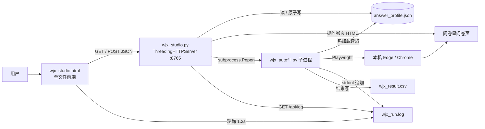

# 项目交接（给接手的 AI / 开发者）

> **读完这一份，不需要看历史对话就能继续维护和扩展本项目。**
> 版本：**v1.1.0**（已打标签；v1.0.0 为首发版本；本文件末尾有 v1.1 完整增量章节）｜ 更新：2026-11-13 ｜ 项目目录：`C:/Users/Administrator/WorkBuddy/2026-11-11-15-17-12/wjx-autofill-studio`
>
> 项目已整体归档到 `wjx-autofill-studio/`（含 `.git`，仓库根即此目录）；上层目录只保留 `.workbuddy/` 工作区数据。所有命令都在此目录内执行。

---

## 0. 三十秒版本

一个**本地** Windows 工具，给**用户自己有管理权限的问卷星测试问卷**批量造测试数据。
三层结构：单文件前端 `wjx_studio.html` ↔ 零依赖 HTTP 后端 `wjx_studio.py`(127.0.0.1:8765) → 子进程 `wjx_autofill.py`(Playwright) → 问卷星页面。
**`answer_profile.json` 是唯一数据源**：题目结构、每题规则、整体重心、运行参数全在里面，代码不硬编码任何题目。
最复杂的部分是**安全验证处理**（问卷星风控提示 + 阿里云智能验证），第 6 节专门讲，改之前务必先读。

**这不是**：爬虫、刷票工具、破解验证码的工具、SaaS 服务、有后端数据库的应用。

---

## 1. 项目背景与需求演进

用户（王佩琦，网络工程师，Windows）要做一份自己用问卷星建的测试问卷，批量填几十份来造测试数据，要求并发 3~4 个、能自动点掉「同一 IP 提交多了」的弹窗。需求按顺序演进：

1. 写批量填写脚本 → `wjx_autofill.py`
2. 「运行时能改答案整体重心，偏重/偏轻或在预期范围内」 → `answer_profile.json` + `bias` / `sharpness` / `ratio` + 热加载
3. 「这只是模拟问卷，别的类型怎么办？题目写死了吗？能不能弄个一看就会的可视化界面」 → 题目改为链接抓取 + 全放 JSON，新增工作台
4. 「有安全验证脚本没识别就把浏览器关了；手动点完还得手动关浏览器，效率太低」 → 验证自动处理链路
5. 「鼠标点击随机一点，不要太过平滑」 → 拟人化鼠标（贝塞尔弧线 + 抖动 + 不匀速）
6. 「上传 GitHub 1.0 + 操作手册 + README + 项目交接」 → 本次交付

用户的沟通偏好：**简洁、直接动手、别啰嗦**。技术判断可以主动主导。

---

## 2. 运行环境与启动

| 项 | 值 |
|---|---|
| OS | Windows 10/11 |
| Python | 3.13.x（要求 3.10+） |
| 依赖 | 仅 `playwright`（Python 包）；后端 `wjx_studio.py` 零第三方依赖 |
| 浏览器 | 优先本机 `msedge` → `chrome` → Playwright 自带 Chromium。**不需要** `playwright install chromium`（有 Edge/Chrome 时） |
| 端口 | 8765，只绑 `127.0.0.1` |
| 工作台启动 | `python wjx_studio.py` / 双击 `start.bat` / `--no-browser` / `--port N` |
| 核心脚本启动 | `python wjx_autofill.py [参数]`，或工作台 `/api/run` 以子进程方式启动（带 `--profile <绝对路径>`） |

---

## 3. 架构与数据流



**关键：前端不直接碰核心脚本**，所有交互走 HTTP；`/api/run` 用 `subprocess.Popen` 起子进程并把 stdout/stderr 追到 `wjx_run.log`，前端靠轮询 `/api/log` 显示进度。子进程读同一个 `answer_profile.json`，所以运行时改配置能热加载。

### 请求流（一次完整使用）

1. `/api/parse` → `fetch_page(url)` 下载问卷 HTML → `parse_html()` 按 `<div class="field ui-field-contain">` 切块、按 `<input name>` 分组，产出 `questions_meta`（含真实 input id）+ `default_questions()` 产出每题默认规则
2. 前端渲染 → `/api/preview` → `core.Sampler(profile_dict=...)` + `core.distribution(s, 300)` 模拟 300 份，返回每题占比 + `severity`
3. `/api/save` → `save_profile()` 原子替换（先写 `.json.tmp` 再 `os.replace`）
4. `/api/run` → 先 `check_env()`，再保存配置、清空日志、起子进程
5. 子进程 `run()` → `asyncio.Semaphore(CONCURRENCY)` 并发 `submit_one()`，每份一个 `browser.new_context()`

---

## 4. 文件职责

| 文件 | 行数级 | 职责 | 改动注意 |
|---|---|---|---|
| `wjx_studio.html` | ~370 | 界面 + 状态管理 + 自动保存 + 轮询日志 | 纯原生 JS，无构建；改完用 `node --check` 校验抽出的 `<script>` |
| `wjx_studio.py` | ~305 | 题目解析、HTTP API、环境检查、子进程管理 | `read_profile()` 有缺文件兜底；`save_profile()` 必须保持原子替换 |
| `wjx_autofill.py` | ~900 | 答案抽样、Playwright 填写、验证处理、自适应节流接入、CSV 输出 | 最复杂；第 6 节所有常量别乱动 |
| `validate_profile.py` | ~250 | 配置体检 + `MAX_CONCURRENCY` 等并发上限单一数据源 | 纯函数、零依赖，别 import 核心脚本 |
| `throttle.py` | ~130 | `AdaptiveLimiter` 自适应节流器 | `ContextVar` 按 Task 隔离，改动前读 A.2 |
| `tests/` | — | 72 个零依赖 `unittest` 用例 | 跑 `python -m unittest discover -s tests -v` |
| `answer_profile.json` | — | **唯一数据源** | 由工作台生成/保存，一般不手改 |
| `start.bat` / `install.bat` | — | 一键启动 / 装依赖 | `install.bat` 用阿里云镜像，失败提示备用源 |
| `README.md` | — | 项目概览、快速开始、配置说明 | 面向使用者 |
| `操作手册.md` | — | 逐步操作、状态对照、FAQ | 面向小白 |
| `项目交接.md` | 本文件 | 技术交接 | 面向 AI / 接手者 |
| `.gitignore` | — | 排除运行产物与工作区数据 | `.workbuddy/` 必须排除 |

**运行产物（不入库）**：`wjx_result.csv`、`wjx_run.log`、`__pycache__/`、`*.json.tmp`。

---

## 5. 核心算法：`Sampler`（`wjx_autofill.py`）

### 5.1 权重与缺口补偿抽样

- `_weights(q, n)`：
  - `ratio` → 归一化后的固定权重
  - `off` / `uniform` → 均匀
  - `trend` → `k = sharpness × bias × dir × strength`，`w[i] = exp(k × (2i/(n-1) − 1))` 后归一化
- `_pick_one()` 用**缺口补偿**：`score[i] = w[i] × (done+1) − counts[q][i] + 随机微扰`，取最大。
  效果：实际累计分布紧贴目标权重，而不是靠独立采样碰运气。
- `_pick_multi()`：每选项独立概率 + 补齐 `min` / 截断 `max`
- `_pick_text()`：优先 `texts` 文本池，否则按 bias 选一组预设中文短句

### 5.2 精确配额

`{"mode":"ratio","ratio":[0,0,0.2,0.3,0.5]}` × 20 份 → 严格 `[0,0,4,6,10]`（已实测）。

### 5.3 热加载

`_reload()` 每份答案前读一次文件；`_sig()` = `bias + sharpness + questions` 的 JSON 签名。
**签名变化就清零 `counts` 和 `done`**，所以运行时改重心是「下一份立刻生效」，不会被历史累计拖着渐变。控制台打印 `[重心已更新]`。

### 5.4 整体倾向值

`severity_index()` 返回 0~1。排除 `ratio` / `off` / `uniform` / 非 radio 的题（避免性别等人口属性题污染倾向值）。
实测 `bias = -0.8 / 0 / +0.8` → `0.15 / 0.50 / 0.85`。

### 5.5 答案落到页面

`APPLY_JS` 用 `questions_meta` 里的真实 input id 定位：
**问卷星选项的 `input` 是 `display:none`，必须点 `div.label[for=qN_M]` 或 `a.jqradio`**，再 `inp.checked=true` + 派发 `change` 事件。只设 `checked` 无效。
填空题按 `div.field[topic='N']` 找容器写 `value` 并派发 `input`/`change`。

---

## 6. 安全验证处理链路（**最容易改坏，务必先读**）

问卷星提交后的链路有两级风控：

```
点 #ctlNext 提交
  ├─ 成功 → 整页跳到 /wjx/join/completemobile2.aspx?activityid=...&joinactivity=...
  ├─ 风控级 1：layui 弹层「需要安全校验，请重新提交！」+ [确认] 按钮
  │            → 必须点确认，然后【立刻重新点 #ctlNext】
  │            → 重提交才会弹风控级 2，点掉确认却撒手不管 = 页面停住干等
  └─ 风控级 2：阿里云智能验证弹窗 #aliyunCaptcha-window-popup
               → 内部 #aliyunCaptcha-checkbox-icon 就是「点击开始智能验证」那个 20×20 方框
               → 点它 → 服务端无感校验 → 通过则弹窗消失、页面继续提交
               → 失败时显示「验证失败，请刷新」并换新的 CertifyId，可点刷新重试
```

### 6.1 `wait_result()` 判定优先级（不要调换顺序）

1. **URL**：`SUCCESS_URL_MARKS` 命中 `completemobile2.aspx` / `/wjx/join/complete` → `ok`（最可靠，正常提交 1 秒即可判定）
2. **正文兜底**：`SUCCESS_WORDS` / `BLOCK_WORDS`
3. **`SAFETY_HINT_JS`**：扫 layui 弹层文本 → `kind=recheck` 走「点确认 + 立刻重提交」；`kind=blocked` 直接 `ip_blocked`
4. **`ALIYUN_STATE_JS`**：弹窗可见 → `handle_captcha()` 自动点 / 刷新重试，必要时 `try_auto_slider()`
5. **主动重试提交**：没弹窗也没结果就补点 `#ctlNext`（首次 2 秒、之后每 6 秒，最多 `MAX_RESUBMIT=3`）
6. **无进展放弃**：`IDLE_TIMEOUT=25` 秒无任何动静 → `no_response`，快速跳过继续下一批

### 6.2 关键常量与参数

| 名称 | 值 | 说明 |
|---|---|---|
| `SUCCESS_URL_MARKS` | `completemobile` 等 | 成功页 URL 特征 |
| `SUCCESS_WORDS` | 含「答卷**已经**提交」「感谢您的参与」等 | 中文兜底 |
| `ALIYUN_POPUP` / `_CHECK` / `_CLOSE` / `_REFRESH` | `#aliyunCaptcha-*` | 按 id 精确识别 |
| `VERIFY_TIMEOUT` | 45 | 单次等待基数 |
| `VERIFY_MAX_WAIT` | 60 | 人工过验证额外宽限 |
| `VERIFY_GRACE` | 30 | 弹窗可见时顺延计时 |
| `IDLE_TIMEOUT` | 25 | 无进展快速放弃 |
| `MAX_RESUBMIT` | 3 | 补点提交次数 |
| `KEEP_WINDOW_ON_FAIL` | `False` | **窗口一律脚本自己关** |

### 6.3 反指纹与拟人化

- `STEALTH_JS`（`ctx.add_init_script`）：隐藏 `navigator.webdriver`，伪造 `languages` / `plugins` / `window.chrome` / `permissions.query`
- UA 与内核对齐：`UA_EDGE`（带 `Edg/131`）用于 msedge，`UA_CHROME` 用于 chrome；**不要用 Firefox UA 配 Edge 内核**（自相矛盾，反指纹直接判高风险）
- 启动参数：`--disable-blink-features=AutomationControlled`、`ignore_default_args=["--enable-automation"]`
- 拟人化鼠标：`_rand_curve()` 三次贝塞尔随机弧度 → `human_move()` 弧线 + 缓入缓出 + 逐点抖动 + 7~30ms 随机间隔 → `human_click()` 元素内随机偏移 + 按下抬起 45~115ms 随机停顿；`try_auto_slider()` 拖动带抖动和过冲回弹

### 6.4 状态枚举

`STATUS_CN`：`ok` / `need_verify` / `timeout` / `ip_blocked` / `error` / `dry_run` / `no_submit_button` / `no_response`。
备注写入 CSV 前用 `dict.fromkeys(notes)` 去重，防止刷屏。

---

## 7. HTTP API（`wjx_studio.py`）

| 方法 | 路径 | 入参 | 返回 |
|---|---|---|---|
| GET | `/` `/index.html` | — | HTML 页面 |
| GET | `/api/profile` | — | 当前 `answer_profile.json` 内容 |
| GET | `/api/env` | — | `{ok, msg}`，检查 playwright 与浏览器 |
| GET | `/api/log` | — | `{running, text}`（日志末尾 16000 字） |
| GET | `/api/limits` | — | `{max, recommended, note}`，并发上限单一数据源 |
| POST | `/api/validate` | `{profile}` | `{ok, errors, warnings, hints, summary}` 配置体检 |
| POST | `/api/parse` | `{url}` 或 `{html}` | `{meta, defaults, count, url}` |
| POST | `/api/preview` | `{profile, total}` | `{dist:{q:{pct,labels}}, severity}` |
| POST | `/api/save` | `{profile}` | `{ok:true}` |
| POST | `/api/run` | `{profile}` | `{ok:true}` / `{error}` |
| POST | `/api/stop` | `{}` | `{ok:true}` |

`parse_html()` 支持单选/多选/填空/矩阵量表多组选项；找不到 radio/checkbox 的题块按 `kind:"text"` 兜底。矩阵/量表多组时 key 是 input 的 `name`，标题加「· 第N组」。

---

## 8. 关键设计决策（及原因）

| 决策 | 原因 |
|---|---|
| 题目全放 JSON，代码不硬编码 | 用户明确要「换问卷不用改代码」 |
| 后端零第三方依赖（标准库 `http.server`） | 避免装 Flask/FastAPI，双击 bat 就能跑 |
| 只绑 `127.0.0.1` | 本地工具，不对外暴露 |
| 前端与核心脚本之间用子进程 + 日志文件中转 | 便于启停、实时日志，子进程崩了不影响工作台 |
| `save_profile()` 原子替换 | 子进程热加载时不会读到写了一半的 JSON |
| 优先复用本机 Edge/Chrome | 免下载 Chromium；本机 pip 官方源超时，换阿里云镜像才装上 |
| 并发用多个 `browser.new_context()` | 隔离 cookie / localStorage，模拟不同答卷者 |
| 成功判定以 URL 为主、文案为辅 | 中文文案改一个字就全盘误判（见 9.1） |
| 失败窗口一律自动关闭 | 早期版本保留窗口导致用户必须手动关，效率极低 |

---

## 9. 踩过的坑（**改代码前逐条对照，别重犯**）

### 9.1 成功文案差一个字，导致每份都被误判超时
页面实际是「您的答卷**已经**提交，感谢您的参与！」，早期词表写的是「您的答卷已提交」「谢谢参与」→ **一个都不匹配** → 每份判 `timeout` → 旧逻辑对 timeout 保留窗口不关 → 用户必须手动关浏览器。这是「效率太低」的真正元凶，跟验证无关。

### 9.2 `position:fixed` 元素的 `offsetParent` 恒为 `null`
阿里云弹窗 `#aliyunCaptcha-window-popup` 是 `position:fixed`。早期 `ALIYUN_STATE_JS` 用 `pop.offsetParent !== null` 判可见 → **永远 false，验证弹窗一次都没被识别过**。
正确：用 `getBoundingClientRect()` 尺寸 + `display/visibility/opacity`，并对 fixed 放行。`DISMISS_JS` 里早就有 `if (box.offsetParent === null && st.position !== 'fixed') continue;`，抄过来时漏了。
另：Playwright 的 `locator.is_visible()` 不受 offsetParent 影响，优先用它。

### 9.3 不能用 CSS 类名判断「验证通过」
`.aliyunCaptcha-checkbox-checked` / `.aliyunCaptcha-checkbox-icon-checked` 是容器**自带**的样式类，不是通过标志。曾误加进 `success` 判断，结果无限刷「验证通过」且从不真正点验证入口，12 份只成功 2 份。
**「通过」以弹窗消失为准**，配合 URL 判定。

### 9.4 「需要安全校验，请重新提交！」点掉确认不算完
layui 弹层原文 `<div class="layui-layer-content">需要安全校验，请重新提交！</div>` + `[确认]`。
`DISMISS_JS` 的按钮词表含「确认」会把它点掉，但**点掉后必须立刻重新提交**，否则页面停在问卷页干等到超时。这就是历史上「零备注 393 秒超时 / 页面无响应」的第三种状态。

### 9.5 不能要求「先出现验证才允许重试提交」
早期 `if verify_clicked and extra_submit < 2 ...` → 提交静默失败且没弹验证时永远不重试，只能干等到 393 秒超时。已改为无条件补点提交 + 无进展快速放弃。

### 9.6 验证挑战不在 iframe 里
实测 frames 只有主页面 + `about:blank`，阿里云这是**无感/智能校验**，没有可自动拖的滑块。`try_auto_slider()` 是兼容其它验证类型的兜底，本次问卷靠自动点击 checkbox + 失败刷新重试过关。

### 9.7 前端 `parse` 会保留旧配置
`/api/parse` 返回 `defaults`，前端用 `old[q] || defs[q] || {...}` 合并，**不会覆盖用户已设的每题规则**。所以配置文件里若出现「不合语义」的 dir，多半是界面上点过，不是被自动重置。

### 9.8 工具与工程习惯
- 用 `Edit` 改 `wjx_autofill.py` 里含大量 `\"` 的 JS 字符串常匹配失败 → 把新代码块写入临时文件，再用 Python `s.find()` 定位边界切片替换，稳定得多。
- 每次改完跑 `python -m py_compile wjx_autofill.py wjx_studio.py`，前端抽出 `<script>` 跑 `node --check`。
- 用 `curl` 测本地服务要加 `--noproxy '*'`，否则走代理会返回 502 误判成服务挂了。

---

## 10. 实测数据（2026-11-13）

| 场景 | 结果 |
|---|---|
| `--total 1 --concurrency 1` | 4.0s 判定提交成功，窗口自动关闭 |
| 修复前 `--total 15 --concurrency 3` | 11/15，4 份 `no_response` 各耗 29 秒 |
| 更早 `--total 12 --concurrency 3` | 2/12，其余各卡 109 秒（无限刷「验证通过」那版） |
| 修复后 `--total 6 --concurrency 3` | **6/6**，4.2~12.9 秒，含 1 份走「风控提示→点确认→重提交→过验证」 |
| 复压 `--total 10 --concurrency 3` | **10/10**，3.5~15.0 秒，全程零手动 |
| 离线 `--preview` bias `-0.8/0/+0.8` | 整体倾向 `0.15 / 0.50 / 0.85` |
| `ratio [0,0,0.2,0.3,0.5]` × 20 | 严格 `[0,0,4,6,10]` |

测试时 IP 处于高频状态，**确实触发了验证**，日志里能看到 `已点击「开始智能验证」(#aliyunCaptcha-checkbox-icon)` 和 `风控提示[需要安全校验，请重新提交！]` → `已按提示重新提交`。

---

## 11. 当前状态与已知问题

### 11.1 配置文件现状（2026-11-13，v1.1 之后）

`answer_profile.json`：`url=https://v.wjx.cn/vm/eudcN9d.aspx`（用户自建的「大学生熬夜情况调查」，单页 7 题）、`total=20`、`concurrency=3`、`headless=false`、`bias=0.6`、`sharpness=2.0`。

| 题 | 题型 | 选项 | 当前规则 | 备注 |
|---|---|---|---|---|
| q1 | radio | 男 / 女 | `ratio [0.5,0.5]` | 合理，性别不跟随重心 |
| q2 | radio | 就寝 5 档 | `ratio [0.202,0.202,0.2424,0.202,0.1515]` | ⚠️ 固定配额，**不受 bias 影响**、不计入整体倾向值；**有意保留**，未擅自改动 |
| q3 | radio | 几点算熬夜 4 档 | `trend dir=1` | |
| q4 | radio | 睡眠时长：少于6h / 6-7 / 7-8 / 多于8h | **`trend dir=-1`** ✅ | v1.1 已修正：重心偏重时倾向「少于6小时」 |
| q5 | radio | 熬夜天数 4 档 | `trend dir=1` | |
| q6 | checkbox | 熬夜原因 5 项 | `multi prob 0.5 / min1 max3` | |
| q7 | radio | 没有影响 / 昏昏欲睡 | **`trend dir=1`** ✅ | v1.1 已修正：重心偏重时倾向「昏昏欲睡」 |

> **v1.1 起 q4/q7 方向已修正**（旧配置备份在 `answer_profile.backup.json`，已 `.gitignore` 排除、不入库）。
> q2 的 `ratio` 保留原样，若想让它跟重心走，在界面点「越靠后越重 ↗」即可。
> 点「配置体检」会列出每题「重心偏重时实际倾向哪个选项」的确定事实，可随时复核方向；
> 当前配置体检结果：**0 error / 2 warning**（两条都是 q1、q2 被固定配额锁死的提醒）。

### 11.2 其它已知限制

- 多个 context **共用同一公网 IP**，问卷星仍可能直接拒绝；彻底隔离要配 `CFG["PROXIES"]` 代理池。
- 只在**单页 7 题**问卷上真机验证过；多页 / 跳题 / 矩阵量表虽在解析层兼容，但**未做端到端实测**。
- 阿里云智能验证是服务端风险判定，自动点击不保证 100% 通过；失败会记录 `need_verify` 或 `no_response` 并跳过，不阻塞整批。
- 无验证码破解 / 打码平台 / OCR，遇到点选式验证仍需人工。
- **开放题**已在模拟问卷星结构的真实浏览器 DOM 上验证填写/留白/定位失败报错，
  并新增 `verify_open_text.py` 离线自检（见 A.8）。**仅剩「服务端是否收到文本」**
  需在自己有权限的测试问卷里加一道选填开放题、真跑 1 份看后台，不需要提供问卷链接。

---

## 12. 后续可做的方向（按价值排序）

**v1.1 已完成，不要再当待办**（详见附录 A）：配置方向修正、配置体检、自适应节流、
开放题完整支持、并发上限 1~4、64 个零依赖单测（后续复用性加固增至 72）、集成级接线测试。

剩余待办：

1. **开放题后台核对**（可选人工步骤）— 用户已把测试问卷改成 8 题（末题为开放题），
   脚本重新抓题后真跑 2/2 + 1/1 提交成功，CSV 备注记录了实际填入文本
   （`开放题实际填写: q8='...'`）。只剩用户去后台看一眼文字是否收到。
2. **代理池** — `CFG["PROXIES"]` 已留接口，做成分上下文轮换 + 健康检查；这是唯一能真正突破同 IP 风控的路子。
3. **多页 / 跳题 / 矩阵量表端到端实测** — `submit_one()` 已处理「下一页/下一题」，但未用真问卷验证。
4. **失败补跑队列** — `need_verify` / `no_response` 的份自动排队重试，而不是直接算失败。
5. **配置版本化** — `questions_meta` 与 `questions` 分离存储，避免重新抓题时丢规则。
6. **结果可视化** — CSV 实际分布与预览目标分布并排对照。
7. **工程化** — `requirements.txt`、`LICENSE`、GitHub Actions（py_compile + node --check + unittest）。

---

## 13. 维护约定

- **改配置**：优先在界面改 → `/api/save`（原子写）。手改 JSON 后脚本会自动热加载。
- **改核心脚本**：先 `python -m py_compile`；再 `--preview` 验分布；再 `--dry-run --total 2` 验选项点中；最后小批量真跑。
- **改前端**：抽出 `<script>` 用 `node --check` 校验；界面步骤标题与 `操作手册.md` 要同步。
- **不要删** `.workbuddy/`（工作区数据，非临时缓存），它已在 `.gitignore` 中排除。
- **不要提交** `wjx_result.csv` / `wjx_run.log`（运行产物）。
- **发版流程**：改 `README.md` 的版本段 → commit → `git push github main` → 用 GitHub API 建 Release 生成标签（不要 `git push tag`，代理常 502）。

---

## 14. 用途边界（务必保留）

仅用于**用户自己创建、有管理权限的测试问卷**，用来造测试数据、验证题目跳转、必填校验和提交流程。
**禁止**用于他人问卷、刷票、刷量，或影响任何真实调查的统计结果。
项目里所有反指纹 / 拟人化措施的目的，是让自建问卷的自动化测试流程能跑通，不是绕过他人系统的安全机制。


---

# 附录：v1.1 增量（2026-11-13，接手必读）

> 这里是 v1.1 增量的完整技术说明；正文（第 1~14 节）已同步到当前状态，本节补充设计细节、压测数据与踩坑记录。

## A. 这一轮做了什么

| 项 | 状态 |
|---|---|
| 修配置方向 q4 `dir=-1`、q7 `dir=1` | ✅ 已改（原文件备份在 `answer_profile.backup.json`，不入库） |
| 配置体检 `validate_profile.py` + `/api/validate` + 界面按钮 | ✅ 新增 |
| 自适应节流 `throttle.py` + 接入 `wait_result`/`submit_one`/`run` | ✅ 新增 |
| 零依赖单测 | ✅ 72 个用例，`python -m unittest discover -s tests -v` |
| 并发上限 1~4 + `/api/limits` 单一数据源 | ✅ 新增 |
| 开放题（文本题）完整支持 | ✅ 新增 |

## A.1 配置体检（`validate_profile.py`）

纯函数、零依赖、不 import 核心脚本。输入 profile，输出 `{ok, errors, warnings, hints, summary}`。

- **error** = 确定的结构/取值问题：孤儿规则（换问卷后题号重排）、`ratio` 长度/全零/负数、
  `dir` 非 ±1、`ids` 与选项数不符、顶层参数越界、`text_ids` 类型错等
- **warn** = 能跑但要注意：`ratio`/`off` 锁死不受 bias 影响、开放题没配文案、没抓到输入框 id
- **hints** = **方向的事实描述**，不猜语义。按 `k = sharpness × bias × dir × strength`
  推导「重心偏重时倾向第几个选项」，把选项文字一起列出来让人核对。
  这样 q4/q7 方向配反一眼能看出来，又不会因为中文语义猜测而误报。

界面第 3 步「配置体检」按钮 → `POST /api/validate` → 渲染报告。

## A.2 自适应节流（`throttle.py`）

- 单事件循环里「检查 `active < limit` + `active += 1` 之间不 await」保证原子，**不需要 Lock/Condition**
- `contextvars.ContextVar` 按 Task 隔离：同一份问卷里多个风控信号只降速一次，不同份各自降速
- 信号在 `wait_result` 里**即时上报**（不等这份结束）：问卷星安全校验提示、IP/频率限制、
  阿里云验证弹窗、页面无响应
- 降速：`limit -= 1`（下限 1）、间隔 `×2.5`（上限 ×4）、冷却 6 秒、`clean_streak` 清零
- 恢复：连续 5 份干净 `ok` 后 `limit += 1`、间隔降一档
- `finish(status)` 只对风控类状态降速（`THROTTLE_STATUSES`），`dry_run` / `no_submit_button` 不降速
- **`--no-adaptive` 完全等价固定并发 + 固定间隔**，用于 A/B 对比和回退
- `resolve_concurrency()` 是**并发的单一入口**：界面下拉、配置文件、命令行 `--concurrency`
  都收敛到 `MAX_CONCURRENCY`；超限打印 `[并发收敛]`，只有 `--allow-over-limit` 能放行（压测复现用）
- `enabled=False` 由 `CFG["ADAPTIVE"]` 控制；`run()` 结束打印 `[自适应统计]`

新增 CFG：`ADAPTIVE` / `ADAPTIVE_MIN_CONCURRENCY` / `THROTTLE_COOLDOWN` /
`THROTTLE_GAP_FACTOR` / `ADAPTIVE_RECOVER_AFTER`。

**实测**（10 份并发 3，第 10 份触发验证）：日志出现
`[自适应降速] 并发 3→2｜间隔×2.5｜冷却 6s｜原因: 阿里云智能验证`，
该份仍自动过验证成功，最终 **10/10**，统计 `throttles=1, limit=2, gap_mult=2.5`。

## A.3 并发上限为什么是 4（压测与结论）

`validate_profile.py` 里 `MAX_CONCURRENCY=4`、`RECOMMENDED_CONCURRENCY=3`、
`CONCURRENCY_NOTE` 是**单一数据源**；`/api/limits` 从这里读，前端 init 时动态生成
1~max 的 `<option>` 并把 note 显示在下方；校验器也用同一个上限。

梯度压测（每档 5~6 份，默认开自适应）：

| 并发 | 成功 | 验证触发 | 降速 | 结束时有效并发 | 单份均值 |
|---|---|---|---|---|---|
| 4 | 6/6 | 6 | 6 | 1 | 11.2s |
| 6 | 6/6 | 5 | 5 | 1 | 13.0s |
| 8 | 6/6 | 4 | 4 | 4 | 15.0s |

- 8 个 context 技术上完全能跑（无崩溃），所以上限**不是**本机资源决定的
- 决定性约束是**同一公网 IP 的提交密度**：并发 ≥4 验证几乎每份必现，
  自适应把有效并发压回 1~4，设定 6/8 只是名义值；冷 IP 下并发 3 单份约 3.5~4.5 秒，
  高并发档涨到 11~15 秒 → 边际收益为负
- **压测局限（必须知道）**：低并发对照组（1/2/3）是在连跑几十份之后测的，
  当时出口 IP 已进入高风险状态，连并发 1 都 4/5 触发验证 → **该组数据被 IP 热度污染，
  不能用来论证「低并发也慢」**。真正有效的对比是冷 IP 下并发 3 的历史基线。
- 推论：调并发不如关掉问卷的 IP 限制/智能验证，或配代理池
- 短批里降速后来不及恢复（需连续 5 份干净成功），长批会逐步恢复

前端 `renderTop()` 会把老配置里超限的 `concurrency` **收敛到 1~max**，避免选到不存在的 option。

## A.4 开放题（文本题）处理链路

```
parse_html()
  └─ 无 radio/checkbox 的题块 → kind:"text"
       ├─ 正则收集 <textarea>/<input type=text> 的真实 id → text_ids[]
       └─ default_question_cfg() → {mode:"text", texts:[], blank_rate:0.0}
界面第 3 步
  └─ 开放题卡片 textarea[data-texts]：逐行写文案，写进 cfg.texts
     + input[data-blank]：留白比例
Sampler._pick_text()
  ├─ texts 非空 → random.choice(texts)
  ├─ blank_rate 命中 → ""（留白）
  ├─ follow_bias:true → 按 bias 选偏重/偏轻文案（可选，界面未暴露）
  └─ 否则 → GENERIC_TEXTS 中性通用短句（不会答非所问）
APPLY_JS
  ├─ 优先 payload.textIds[q] 里的真实 id → getElementById
  ├─ 退回 div.field[topic=N] 容器
  ├─ 再退回 qN_1 / qN_1 / txtN 常见命名
  ├─ 找不到 → out[q] = "0/1"（submit_one 会报「页面未找到这些题的选项」）
  ├─ val === "" → out[q]="blank"，保持空，加入 handled 集合
  └─ handled 集合让「兜底填空」不会把留白重新填成「测试」
```

**默认文案从「按 bias 生成熬夜相关句子」改为中性通用短句**：换问卷不会答非所问。
原行为可用 `follow_bias: true` 显式开启。

**实测**（真实浏览器 DOM、模拟问卷星结构，不联网）：精确 id 定位 ✓、题号容器兜底 ✓、
找不到返回 `0/1` ✓、留白不被兜底覆盖 ✓、验证码输入框不被误填 ✓。
**服务端回执尚未确认**：本地 DOM 填写已由 `verify_open_text.py` 覆盖（A.8），
剩下只需用户在自己的测试问卷里加一道选填开放题、真跑 1 份看后台，无需提供链接。

## A.5 新增/改动文件

| 文件 | 变化 |
|---|---|
| `validate_profile.py` | 新增：体检器 + `MAX_CONCURRENCY` / `RECOMMENDED_CONCURRENCY` / `CONCURRENCY_NOTE` |
| `throttle.py` | 新增：`AdaptiveLimiter` |
| `tests/test_core.py` | 新增/扩充：Sampler、校验器、题目解析、并发上限、开放题 |
| `tests/test_throttle.py` | 新增：节流器 13 个用例（含 `enabled=False` 等价旧行为） |
| `tests/test_throttle_wiring.py` | 新增：假 page 精确触发风控分支，验证「接线」而非只测工具类 |
| `wjx_autofill.py` | `GENERIC_TEXTS`、`_pick_text`、`APPLY_JS` 开放题定位、`payload.textIds`、limiter 接入、`--no-adaptive` |
| `wjx_studio.py` | `text_ids` 收集、`/api/limits`、`/api/validate` |
| `wjx_studio.html` | 并发下拉 + 依据说明、配置体检按钮、开放题文本池编辑 |
| `answer_profile.json` | 仅 q4/q7 的 `dir` 修正；**q2 仍为 `ratio` 固定配额**（未擅自改动用户数据） |
| `.gitignore` | 排除 `answer_profile.backup.json` |

## A.6 新增踩坑（续第 9 节）

- **`unittest` 测 `contextvars` 时**：同一个 Task 里连续模拟多份会串标记，
  真实运行每份是独立 Task。测试里要显式 `ContextVar.set(False)` 模拟新的一份。
- **压测会被 IP 热度污染**：连续提交几十份后，低并发对照组也全触发验证，
  不能据此下「并发无关」的结论。梯度压测要标注顺序与热度状态。
- **`APPLY_JS` 找不到填空题原本会静默 `continue`**，导致开放题没填却以为填好了 →
  现在返回 `0/1` 让 `submit_one` 报出来。
- **留白会被「兜底填空」覆盖**：兜底给所有可见空文本框填「测试」，
  必须用 `handled` 集合排除已精确处理过的元素。
- **Bash 里用 `python -c` 嵌套多层引号和中文会被引号吃掉**（报 SyntaxError）。
  含中文/JS 的批量替换一律写成临时 `.py` 脚本文件再执行，用完删除。
- **补丁脚本要「每处 assert 命中次数」**：中途失败时，先算完再写文件能保证
  该文件整体不被半改；但已写入的**其它文件**要单独核对，不能盲目重跑整个补丁。

## A.7 当前状态与验证记录

- `python -m unittest discover -s tests -v` → **72 tests OK**（约 1 秒，零依赖）
- 全部 `.py` `py_compile` 通过；前端 `<script>` `node --check` 通过
- 工作台 `/`、`/api/profile`、`/api/env`、`/api/preview`、`/api/validate`、
  `/api/limits`、`/api/parse` 全部端到端通过；`/api/parse` 对开放题返回 `text_ids:['q8_1']`
- `--preview` → 整体倾向 0.82，q4 60% 落在「少于6小时」、q7 90% 在「昏昏欲睡」（方向已修）
- `--dry-run --total 2 --concurrency 2` → `throttles=0, active=0`，节流不误触发
- `--no-adaptive --dry-run` → `enabled=False`，行为等价旧版
- 真跑 4/4、10/10 均通过；并发梯度 4/6/8 各 6/6（用 `--allow-over-limit` 复现）
- `--concurrency 8` → 打印 `[并发收敛] 8 → 4`；加 `--allow-over-limit` → 打印警告并放行；
  `resolve_concurrency()` 有 5 个单测覆盖（范围内、超限、放行、非法值、警告文案）

**仍待办**：开放题服务端回执确认（可选人工步骤，见 A.8）；代理池；多页/跳题真机验证；
失败补跑队列；`requirements.txt` + `LICENSE`；CI。


## A.8 开放题离线自检工具（v1.1.0 后补）

`verify_open_text.py`：输入一份问卷页源码 HTML，输出识别到的开放题、`text_ids`、体检结果，
以及 `APPLY_JS` 在真实浏览器 DOM 里的填写与回读结果。**严格离线、不提交任何问卷。**

```bash
python verify_open_text.py --html page.html --text "建议增加午休时间"
type page.html | python verify_open_text.py --html -     # 也支持 stdin
```

- `analyze()` 是纯函数（已有 3 个单测），`verify_dom()` 才起 Playwright（headless）
- `ctx.route("http://**" / "https://**")` 用 **async handler** 拦掉所有外部请求；
  用同步 lambda 返回 coroutine 不可靠
- 回读逻辑与 `APPLY_JS` 的兜底一致（真实 id → `div.field[topic=N]`），
  否则「没抓到 id、靠题号兜底填中」的题会被误报成失败
- 结论里明确区分「本地 DOM 填中」与「服务端收到」；后者仍需在有权限的问卷上人工确认一次
- 实测：含「有 id」和「无 id」两道开放题的页面，两题都 `APPLY_JS=text` 且回读一致

**踩坑**：`default_question_cfg` 在 `wjx_autofill`（`core`）里，
`wjx_studio` 只有 `default_questions(meta)`；一开始引用错模块导致 AttributeError。

**为什么这个工具能解开「等用户提供链接」的僵局**：解析与填写能力可以拿任意公开问卷页源码
离线验证（只解析不提交，不越界），唯一需要权限的是「看后台有没有收到文本」——
那一步用户自己点一下即可，无需把链接交给任何人。


## A.9 开放题复用性加固（真实问卷实测后补）

用户把测试问卷改成 **8 题、最后一题为开放题**，并强调「真实情况可能不在最后一题、也可能不止一个填空题，目标是要能复用」。据此做了实打实的验证与修复：

### 发现的真实 bug

`parse_html()` 用 `re.split` 按题块切分，**最后一个题块会带上页面尾部的所有 HTML**。
真实问卷里除了 `input#q8`，还有两个全局输入框：

```
<input type='text' id='q8' name='q8'>
<input type="text" id="matrixinput" placeholder="请注明...">   ← 矩阵题的「请注明」
<input type="text" id="clipVoteCode" readonly="readonly">      ← 投票码，只读
```

修复前 `q8.text_ids = ['q8', 'matrixinput', 'clipVoteCode']`，碰巧 `q8` 排第一才填对；
顺序一变就会填到别人的框里。

### 修复（三层防御）

1. `wjx_studio.py` 新增 `GLOBAL_INPUT_IDS` / `GLOBAL_INPUT_WORDS`，
   收集 `text_ids` 时排除全局占位框、readonly / disabled 元素
2. 与题号匹配的 id 排最前（`q8` / `q8_1` → rank 0），明显属于别的题号的 `q\d+` 降权（rank 2）
3. `APPLY_JS` 与 `verify_open_text.py` 的回读都跳过 `readOnly` / `disabled` 元素

修复后 `q8.text_ids = ['q8']`。

### 复用性验证（位置无关、数量无关）

- 构造 8 题页面，开放题在 **第 2 / 5 / 8 题**（textarea + input 混合、中间与末尾混合），
  尾部同样带 `matrixinput` / `clipVoteCode`
- `parse_html` 全部识别、每题 `text_ids` 独立且干净；`Sampler` 生成 3 个 `__text`；
  `APPLY_JS` 三题分别填中、回读一致 → `verify_open_text.py` 输出 3 个 ✓
- 新增 5 个单测（`TestOpenTextReuse`），全套 **72 tests OK**
- 真实问卷：`text_ids=['q8']`、离线自检 ✓、配置重新抓题后 **真跑 2/2 + 1/1 提交成功**

### 提交前回读（服务端核对的桥梁）

新增 `READBACK_JS`：`submit_one()` 在 `APPLY_JS` 之后回读每道开放题输入框的真实 value，
写进 CSV 备注：`开放题实际填写: q8='希望作息更规律'`。
定位顺序与 `APPLY_JS` 一致（真实 id → `div.field[topic=N]` 兜底），否则靠兜底填中的题会读不到。

### 仍存限制

同一题块内若有多个输入框（例如「姓名 + 建议」），目前只填第一个。
多道开放题各自有输入框则完全支持。若遇到这种复合题，需要扩展 `__text` 为「一题多值」结构。
