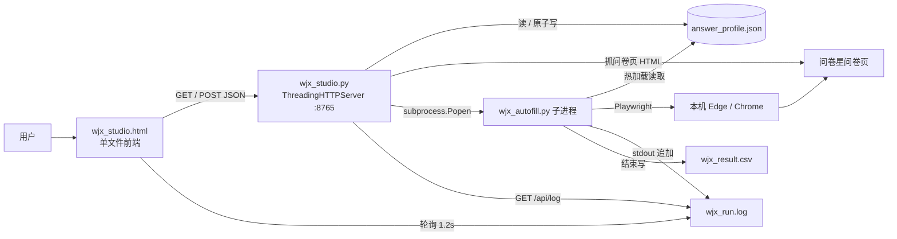

# 项目交接（给接手的 AI / 开发者）

> **读完这一份，不需要看历史对话就能继续维护和扩展本项目。**
> 版本：v1.0.0 ｜ 定稿：2026-11-13 ｜ 工作区：`C:/Users/Administrator/WorkBuddy/2026-11-11-15-17-12`

---

## 0. 三十秒版本

一个**本地** Windows 工具，给**用户自己有管理权限的问卷星测试问卷**批量造测试数据。
三层结构：单文件前端 `wjx_studio.html` ↔ 零依赖 HTTP 后端 `wjx_studio.py`(127.0.0.1:8765) → 子进程 `wjx_autofill.py`(Playwright) → 问卷星页面。
**`answer_profile.json` 是唯一数据源**：题目结构、每题规则、整体重心、运行参数全在里面，代码不硬编码任何题目。
最复杂的部分是**安全验证处理**（问卷星风控提示 + 阿里云智能验证），第 6 节专门讲，改之前务必先读。

**这不是**：爬虫、刷票工具、破解验证码的工具、SaaS 服务、有后端数据库的应用。

---

## 1. 项目背景与需求演进

用户（王佩琦，网络工程师，Windows）要做一份自己用问卷星建的测试问卷，批量填几十份来造测试数据，要求并发 3~4 个、能自动点掉「同一 IP 提交多了」的弹窗。需求按顺序演进：

1. 写批量填写脚本 → `wjx_autofill.py`
2. 「运行时能改答案整体重心，偏重/偏轻或在预期范围内」 → `answer_profile.json` + `bias` / `sharpness` / `ratio` + 热加载
3. 「这只是模拟问卷，别的类型怎么办？题目写死了吗？能不能弄个一看就会的可视化界面」 → 题目改为链接抓取 + 全放 JSON，新增工作台
4. 「有安全验证脚本没识别就把浏览器关了；手动点完还得手动关浏览器，效率太低」 → 验证自动处理链路
5. 「鼠标点击随机一点，不要太过平滑」 → 拟人化鼠标（贝塞尔弧线 + 抖动 + 不匀速）
6. 「上传 GitHub 1.0 + 操作手册 + README + 项目交接」 → 本次交付

用户的沟通偏好：**简洁、直接动手、别啰嗦**。技术判断可以主动主导。

---

## 2. 运行环境与启动

| 项 | 值 |
|---|---|
| OS | Windows 10/11 |
| Python | 3.13.x（要求 3.10+） |
| 依赖 | 仅 `playwright`（Python 包）；后端 `wjx_studio.py` 零第三方依赖 |
| 浏览器 | 优先本机 `msedge` → `chrome` → Playwright 自带 Chromium。**不需要** `playwright install chromium`（有 Edge/Chrome 时） |
| 端口 | 8765，只绑 `127.0.0.1` |
| 工作台启动 | `python wjx_studio.py` / 双击 `start.bat` / `--no-browser` / `--port N` |
| 核心脚本启动 | `python wjx_autofill.py [参数]`，或工作台 `/api/run` 以子进程方式启动（带 `--profile <绝对路径>`） |

---

## 3. 架构与数据流



**关键：前端不直接碰核心脚本**，所有交互走 HTTP；`/api/run` 用 `subprocess.Popen` 起子进程并把 stdout/stderr 追到 `wjx_run.log`，前端靠轮询 `/api/log` 显示进度。子进程读同一个 `answer_profile.json`，所以运行时改配置能热加载。

### 请求流（一次完整使用）

1. `/api/parse` → `fetch_page(url)` 下载问卷 HTML → `parse_html()` 按 `<div class="field ui-field-contain">` 切块、按 `<input name>` 分组，产出 `questions_meta`（含真实 input id）+ `default_questions()` 产出每题默认规则
2. 前端渲染 → `/api/preview` → `core.Sampler(profile_dict=...)` + `core.distribution(s, 300)` 模拟 300 份，返回每题占比 + `severity`
3. `/api/save` → `save_profile()` 原子替换（先写 `.json.tmp` 再 `os.replace`）
4. `/api/run` → 先 `check_env()`，再保存配置、清空日志、起子进程
5. 子进程 `run()` → `asyncio.Semaphore(CONCURRENCY)` 并发 `submit_one()`，每份一个 `browser.new_context()`

---

## 4. 文件职责

| 文件 | 行数级 | 职责 | 改动注意 |
|---|---|---|---|
| `wjx_studio.html` | ~370 | 界面 + 状态管理 + 自动保存 + 轮询日志 | 纯原生 JS，无构建；改完用 `node --check` 校验抽出的 `<script>` |
| `wjx_studio.py` | ~305 | 题目解析、HTTP API、环境检查、子进程管理 | `read_profile()` 有缺文件兜底；`save_profile()` 必须保持原子替换 |
| `wjx_autofill.py` | ~800 | 答案抽样、Playwright 填写、验证处理、CSV 输出 | 最复杂；第 6 节所有常量别乱动 |
| `answer_profile.json` | — | **唯一数据源** | 由工作台生成/保存，一般不手改 |
| `start.bat` / `install.bat` | — | 一键启动 / 装依赖 | `install.bat` 用阿里云镜像，失败提示备用源 |
| `README.md` | — | 项目概览、快速开始、配置说明 | 面向使用者 |
| `操作手册.md` | — | 逐步操作、状态对照、FAQ | 面向小白 |
| `项目交接.md` | 本文件 | 技术交接 | 面向 AI / 接手者 |
| `.gitignore` | — | 排除运行产物与工作区数据 | `.workbuddy/` 必须排除 |

**运行产物（不入库）**：`wjx_result.csv`、`wjx_run.log`、`__pycache__/`、`*.json.tmp`。

---

## 5. 核心算法：`Sampler`（`wjx_autofill.py`）

### 5.1 权重与缺口补偿抽样

- `_weights(q, n)`：
  - `ratio` → 归一化后的固定权重
  - `off` / `uniform` → 均匀
  - `trend` → `k = sharpness × bias × dir × strength`，`w[i] = exp(k × (2i/(n-1) − 1))` 后归一化
- `_pick_one()` 用**缺口补偿**：`score[i] = w[i] × (done+1) − counts[q][i] + 随机微扰`，取最大。
  效果：实际累计分布紧贴目标权重，而不是靠独立采样碰运气。
- `_pick_multi()`：每选项独立概率 + 补齐 `min` / 截断 `max`
- `_pick_text()`：优先 `texts` 文本池，否则按 bias 选一组预设中文短句

### 5.2 精确配额

`{"mode":"ratio","ratio":[0,0,0.2,0.3,0.5]}` × 20 份 → 严格 `[0,0,4,6,10]`（已实测）。

### 5.3 热加载

`_reload()` 每份答案前读一次文件；`_sig()` = `bias + sharpness + questions` 的 JSON 签名。
**签名变化就清零 `counts` 和 `done`**，所以运行时改重心是「下一份立刻生效」，不会被历史累计拖着渐变。控制台打印 `[重心已更新]`。

### 5.4 整体倾向值

`severity_index()` 返回 0~1。排除 `ratio` / `off` / `uniform` / 非 radio 的题（避免性别等人口属性题污染倾向值）。
实测 `bias = -0.8 / 0 / +0.8` → `0.15 / 0.50 / 0.85`。

### 5.5 答案落到页面

`APPLY_JS` 用 `questions_meta` 里的真实 input id 定位：
**问卷星选项的 `input` 是 `display:none`，必须点 `div.label[for=qN_M]` 或 `a.jqradio`**，再 `inp.checked=true` + 派发 `change` 事件。只设 `checked` 无效。
填空题按 `div.field[topic='N']` 找容器写 `value` 并派发 `input`/`change`。

---

## 6. 安全验证处理链路（**最容易改坏，务必先读**）

问卷星提交后的链路有两级风控：

```
点 #ctlNext 提交
  ├─ 成功 → 整页跳到 /wjx/join/completemobile2.aspx?activityid=...&joinactivity=...
  ├─ 风控级 1：layui 弹层「需要安全校验，请重新提交！」+ [确认] 按钮
  │            → 必须点确认，然后【立刻重新点 #ctlNext】
  │            → 重提交才会弹风控级 2，点掉确认却撒手不管 = 页面停住干等
  └─ 风控级 2：阿里云智能验证弹窗 #aliyunCaptcha-window-popup
               → 内部 #aliyunCaptcha-checkbox-icon 就是「点击开始智能验证」那个 20×20 方框
               → 点它 → 服务端无感校验 → 通过则弹窗消失、页面继续提交
               → 失败时显示「验证失败，请刷新」并换新的 CertifyId，可点刷新重试
```

### 6.1 `wait_result()` 判定优先级（不要调换顺序）

1. **URL**：`SUCCESS_URL_MARKS` 命中 `completemobile2.aspx` / `/wjx/join/complete` → `ok`（最可靠，正常提交 1 秒即可判定）
2. **正文兜底**：`SUCCESS_WORDS` / `BLOCK_WORDS`
3. **`SAFETY_HINT_JS`**：扫 layui 弹层文本 → `kind=recheck` 走「点确认 + 立刻重提交」；`kind=blocked` 直接 `ip_blocked`
4. **`ALIYUN_STATE_JS`**：弹窗可见 → `handle_captcha()` 自动点 / 刷新重试，必要时 `try_auto_slider()`
5. **主动重试提交**：没弹窗也没结果就补点 `#ctlNext`（首次 2 秒、之后每 6 秒，最多 `MAX_RESUBMIT=3`）
6. **无进展放弃**：`IDLE_TIMEOUT=25` 秒无任何动静 → `no_response`，快速跳过继续下一批

### 6.2 关键常量与参数

| 名称 | 值 | 说明 |
|---|---|---|
| `SUCCESS_URL_MARKS` | `completemobile` 等 | 成功页 URL 特征 |
| `SUCCESS_WORDS` | 含「答卷**已经**提交」「感谢您的参与」等 | 中文兜底 |
| `ALIYUN_POPUP` / `_CHECK` / `_CLOSE` / `_REFRESH` | `#aliyunCaptcha-*` | 按 id 精确识别 |
| `VERIFY_TIMEOUT` | 45 | 单次等待基数 |
| `VERIFY_MAX_WAIT` | 60 | 人工过验证额外宽限 |
| `VERIFY_GRACE` | 30 | 弹窗可见时顺延计时 |
| `IDLE_TIMEOUT` | 25 | 无进展快速放弃 |
| `MAX_RESUBMIT` | 3 | 补点提交次数 |
| `KEEP_WINDOW_ON_FAIL` | `False` | **窗口一律脚本自己关** |

### 6.3 反指纹与拟人化

- `STEALTH_JS`（`ctx.add_init_script`）：隐藏 `navigator.webdriver`，伪造 `languages` / `plugins` / `window.chrome` / `permissions.query`
- UA 与内核对齐：`UA_EDGE`（带 `Edg/131`）用于 msedge，`UA_CHROME` 用于 chrome；**不要用 Firefox UA 配 Edge 内核**（自相矛盾，反指纹直接判高风险）
- 启动参数：`--disable-blink-features=AutomationControlled`、`ignore_default_args=["--enable-automation"]`
- 拟人化鼠标：`_rand_curve()` 三次贝塞尔随机弧度 → `human_move()` 弧线 + 缓入缓出 + 逐点抖动 + 7~30ms 随机间隔 → `human_click()` 元素内随机偏移 + 按下抬起 45~115ms 随机停顿；`try_auto_slider()` 拖动带抖动和过冲回弹

### 6.4 状态枚举

`STATUS_CN`：`ok` / `need_verify` / `timeout` / `ip_blocked` / `error` / `dry_run` / `no_submit_button` / `no_response`。
备注写入 CSV 前用 `dict.fromkeys(notes)` 去重，防止刷屏。

---

## 7. HTTP API（`wjx_studio.py`）

| 方法 | 路径 | 入参 | 返回 |
|---|---|---|---|
| GET | `/` `/index.html` | — | HTML 页面 |
| GET | `/api/profile` | — | 当前 `answer_profile.json` 内容 |
| GET | `/api/env` | — | `{ok, msg}`，检查 playwright 与浏览器 |
| GET | `/api/log` | — | `{running, text}`（日志末尾 16000 字） |
| POST | `/api/parse` | `{url}` 或 `{html}` | `{meta, defaults, count, url}` |
| POST | `/api/preview` | `{profile, total}` | `{dist:{q:{pct,labels}}, severity}` |
| POST | `/api/save` | `{profile}` | `{ok:true}` |
| POST | `/api/run` | `{profile}` | `{ok:true}` / `{error}` |
| POST | `/api/stop` | `{}` | `{ok:true}` |

`parse_html()` 支持单选/多选/填空/矩阵量表多组选项；找不到 radio/checkbox 的题块按 `kind:"text"` 兜底。矩阵/量表多组时 key 是 input 的 `name`，标题加「· 第N组」。

---

## 8. 关键设计决策（及原因）

| 决策 | 原因 |
|---|---|
| 题目全放 JSON，代码不硬编码 | 用户明确要「换问卷不用改代码」 |
| 后端零第三方依赖（标准库 `http.server`） | 避免装 Flask/FastAPI，双击 bat 就能跑 |
| 只绑 `127.0.0.1` | 本地工具，不对外暴露 |
| 前端与核心脚本之间用子进程 + 日志文件中转 | 便于启停、实时日志，子进程崩了不影响工作台 |
| `save_profile()` 原子替换 | 子进程热加载时不会读到写了一半的 JSON |
| 优先复用本机 Edge/Chrome | 免下载 Chromium；本机 pip 官方源超时，换阿里云镜像才装上 |
| 并发用多个 `browser.new_context()` | 隔离 cookie / localStorage，模拟不同答卷者 |
| 成功判定以 URL 为主、文案为辅 | 中文文案改一个字就全盘误判（见 9.1） |
| 失败窗口一律自动关闭 | 早期版本保留窗口导致用户必须手动关，效率极低 |

---

## 9. 踩过的坑（**改代码前逐条对照，别重犯**）

### 9.1 成功文案差一个字，导致每份都被误判超时
页面实际是「您的答卷**已经**提交，感谢您的参与！」，早期词表写的是「您的答卷已提交」「谢谢参与」→ **一个都不匹配** → 每份判 `timeout` → 旧逻辑对 timeout 保留窗口不关 → 用户必须手动关浏览器。这是「效率太低」的真正元凶，跟验证无关。

### 9.2 `position:fixed` 元素的 `offsetParent` 恒为 `null`
阿里云弹窗 `#aliyunCaptcha-window-popup` 是 `position:fixed`。早期 `ALIYUN_STATE_JS` 用 `pop.offsetParent !== null` 判可见 → **永远 false，验证弹窗一次都没被识别过**。
正确：用 `getBoundingClientRect()` 尺寸 + `display/visibility/opacity`，并对 fixed 放行。`DISMISS_JS` 里早就有 `if (box.offsetParent === null && st.position !== 'fixed') continue;`，抄过来时漏了。
另：Playwright 的 `locator.is_visible()` 不受 offsetParent 影响，优先用它。

### 9.3 不能用 CSS 类名判断「验证通过」
`.aliyunCaptcha-checkbox-checked` / `.aliyunCaptcha-checkbox-icon-checked` 是容器**自带**的样式类，不是通过标志。曾误加进 `success` 判断，结果无限刷「验证通过」且从不真正点验证入口，12 份只成功 2 份。
**「通过」以弹窗消失为准**，配合 URL 判定。

### 9.4 「需要安全校验，请重新提交！」点掉确认不算完
layui 弹层原文 `<div class="layui-layer-content">需要安全校验，请重新提交！</div>` + `[确认]`。
`DISMISS_JS` 的按钮词表含「确认」会把它点掉，但**点掉后必须立刻重新提交**，否则页面停在问卷页干等到超时。这就是历史上「零备注 393 秒超时 / 页面无响应」的第三种状态。

### 9.5 不能要求「先出现验证才允许重试提交」
早期 `if verify_clicked and extra_submit < 2 ...` → 提交静默失败且没弹验证时永远不重试，只能干等到 393 秒超时。已改为无条件补点提交 + 无进展快速放弃。

### 9.6 验证挑战不在 iframe 里
实测 frames 只有主页面 + `about:blank`，阿里云这是**无感/智能校验**，没有可自动拖的滑块。`try_auto_slider()` 是兼容其它验证类型的兜底，本次问卷靠自动点击 checkbox + 失败刷新重试过关。

### 9.7 前端 `parse` 会保留旧配置
`/api/parse` 返回 `defaults`，前端用 `old[q] || defs[q] || {...}` 合并，**不会覆盖用户已设的每题规则**。所以配置文件里若出现「不合语义」的 dir，多半是界面上点过，不是被自动重置。

### 9.8 工具与工程习惯
- 用 `Edit` 改 `wjx_autofill.py` 里含大量 `\"` 的 JS 字符串常匹配失败 → 把新代码块写入临时文件，再用 Python `s.find()` 定位边界切片替换，稳定得多。
- 每次改完跑 `python -m py_compile wjx_autofill.py wjx_studio.py`，前端抽出 `<script>` 跑 `node --check`。
- 用 `curl` 测本地服务要加 `--noproxy '*'`，否则走代理会返回 502 误判成服务挂了。

---

## 10. 实测数据（2026-11-13）

| 场景 | 结果 |
|---|---|
| `--total 1 --concurrency 1` | 4.0s 判定提交成功，窗口自动关闭 |
| 修复前 `--total 15 --concurrency 3` | 11/15，4 份 `no_response` 各耗 29 秒 |
| 更早 `--total 12 --concurrency 3` | 2/12，其余各卡 109 秒（无限刷「验证通过」那版） |
| 修复后 `--total 6 --concurrency 3` | **6/6**，4.2~12.9 秒，含 1 份走「风控提示→点确认→重提交→过验证」 |
| 复压 `--total 10 --concurrency 3` | **10/10**，3.5~15.0 秒，全程零手动 |
| 离线 `--preview` bias `-0.8/0/+0.8` | 整体倾向 `0.15 / 0.50 / 0.85` |
| `ratio [0,0,0.2,0.3,0.5]` × 20 | 严格 `[0,0,4,6,10]` |

测试时 IP 处于高频状态，**确实触发了验证**，日志里能看到 `已点击「开始智能验证」(#aliyunCaptcha-checkbox-icon)` 和 `风控提示[需要安全校验，请重新提交！]` → `已按提示重新提交`。

---

## 11. 当前状态与已知问题

### 11.1 配置文件现状（2026-11-13 快照，未擅自修改）

`answer_profile.json`：`url=https://v.wjx.cn/vm/eudcN9d.aspx`（用户自建的「大学生熬夜情况调查」，单页 7 题）、`total=20`、`concurrency=3`、`headless=false`、`bias=0.6`、`sharpness=2.0`。

题目与规则：

| 题 | 题型 | 选项 | 当前规则 | 备注 |
|---|---|---|---|---|
| q1 | radio | 男 / 女 | `ratio [0.5,0.5]` | 合理，性别不跟随 |
| q2 | radio | 就寝 5 档 | **`ratio [0.202,0.202,0.2424,0.202,0.1515]`** | ⚠️ 固定配额，**不受 bias 影响**，也不计入整体倾向值 |
| q3 | radio | 几点算熬夜 4 档 | `trend dir=1` | |
| q4 | radio | 睡眠时长：少于6h / 6-7 / 7-8 / 多于8h | **`trend dir=1`** | ⚠️ 与语义相反：熬夜严重应倾向「少于6小时」=选项1，应 `dir=-1` |
| q5 | radio | 熬夜天数 4 档 | `trend dir=1` | |
| q6 | checkbox | 熬夜原因 5 项 | `multi prob 0.5 / min1 max3` | |
| q7 | radio | 没有影响 / 昏昏欲睡 | **`trend dir=-1`** | ⚠️ 与语义相反：熬夜严重应倾向「昏昏欲睡」=选项2，应 `dir=1` |

> **q4 和 q7 的 dir 是互换的**（11-11 曾判定并修过一次，当前文件里又变回去了；前端 `parse` 会保留旧配置，所以多半是界面上点过或后续保存覆盖了）。
> q2 的 `ratio` 可能是试「固定比例」功能时留下的。
> **这些是配置数据，不是代码 bug**。本次发版未擅自改动用户数据；如需修正，在界面上把 q4 点「越靠前越重 ↘」、q7 点「越靠后越重 ↗」，或改 JSON 后保存。

### 11.2 其它已知限制

- 多个 context **共用同一公网 IP**，问卷星仍可能直接拒绝；彻底隔离要配 `CFG["PROXIES"]` 代理池。
- 只在**单页 7 题**问卷上真机验证过；多页 / 跳题 / 矩阵量表虽在解析层兼容，但**未做端到端实测**。
- 阿里云智能验证是服务端风险判定，自动点击不保证 100% 通过；失败会记录 `need_verify` 或 `no_response` 并跳过，不阻塞整批。
- 无验证码破解 / 打码平台 / OCR，遇到点选式验证仍需人工。

---

## 12. 后续可做的方向（按价值排序）

1. **修配置方向**：q4 → `dir=-1`、q7 → `dir=1`；确认 q2 是否要退回 `trend`。
2. **自适应节流**：检测到风控提示 / 验证时，全局自动降并发 + 拉长 `MIN_GAP/MAX_GAP`，从源头减少触发。
3. **代理池**：`CFG["PROXIES"]` 已留接口，做成分上下文轮换 + 健康检查。
4. **多页 / 跳题端到端实测**：`submit_one()` 里已处理「下一页/下一题」按钮，但需真问卷验证。
5. **配置版本化**：把 `questions_meta` 与 `questions` 分离存储，避免重新抓题时丢规则。
6. **结果可视化**：CSV 直接出分布图，和预览的目标分布对照。
7. **验证失败降级**：`need_verify` 的份自动排队重试，而不是直接跳过。

---

## 13. 维护约定

- **改配置**：优先在界面改 → `/api/save`（原子写）。手改 JSON 后脚本会自动热加载。
- **改核心脚本**：先 `python -m py_compile`；再 `--preview` 验分布；再 `--dry-run --total 2` 验选项点中；最后小批量真跑。
- **改前端**：抽出 `<script>` 用 `node --check` 校验；界面步骤标题与 `操作手册.md` 要同步。
- **不要删** `.workbuddy/`（工作区数据，非临时缓存），它已在 `.gitignore` 中排除。
- **不要提交** `wjx_result.csv` / `wjx_run.log`（运行产物）。
- **发版流程**：改 `README.md` 的版本段 → commit → `git push github main` → 用 GitHub API 建 Release 生成标签（不要 `git push tag`，代理常 502）。

---

## 14. 用途边界（务必保留）

仅用于**用户自己创建、有管理权限的测试问卷**，用来造测试数据、验证题目跳转、必填校验和提交流程。
**禁止**用于他人问卷、刷票、刷量，或影响任何真实调查的统计结果。
项目里所有反指纹 / 拟人化措施的目的，是让自建问卷的自动化测试流程能跑通，不是绕过他人系统的安全机制。
